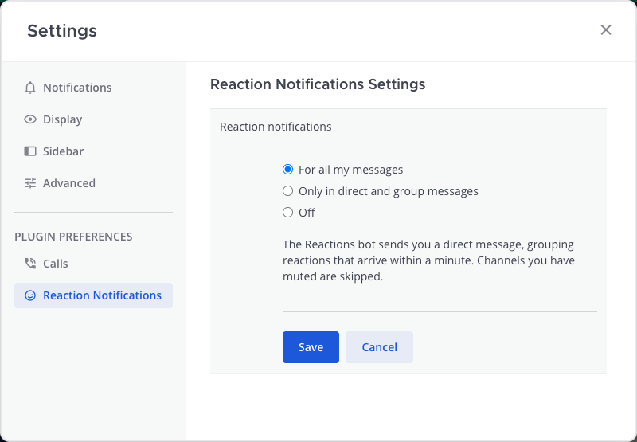

# Reaction Notifications for Mattermost

Get notified when someone reacts to your message. Mattermost shows reactions on the post but
never notifies the author — not on desktop, not on mobile, not by email. This plugin closes that
gap with a short, grouped direct message from a *Reactions* bot.

> **reactions** BOT
> 👍 🎉 😍 **@member** reacted to your message in ~Marketing
> > Campaign brief for the autumn launch is ready — comments welcome by Thursday 🙏
>
> [Open message](#)

## Features

- **A DM when someone reacts** to your message, reply or file: who reacted, which emoji, where,
  a quote of the message and an **Open message** link. Because it's a normal DM, it notifies
  on desktop and phone like any other.
- **Grouped:** reactions to the same message within a minute become one notification —
  "👍 🎉 **@ayse**, **@mehmet** and 3 others reacted to your message in ~marketing".
- **Quiet by design:** no notification for your own reactions, for bots, for system messages,
  for channels you've muted or left, or for a reaction that was taken back within the minute.
- **Your choice** in **Settings → Reaction Notifications**: for all your messages (default),
  only in direct and group messages, or off.



## Install

Requires Mattermost **10.11** or later. Tested on **11.7** and **12.0** with the same build.

1. Download `dev.patika.reaction-notifications-<version>.tar.gz` from the
   [latest release](https://github.com/PatikaDev/mattermost-plugin-reaction-notifications/releases/latest)
   (`SHA256SUMS` is attached for verification).
2. **System Console → Plugins → Plugin Management → Upload Plugin**, choose the file, then
   **Enable**. Plugin uploads must be allowed (`PluginSettings.EnableUploads`).

Or with `mmctl`:

```bash
mmctl plugin add dev.patika.reaction-notifications-<version>.tar.gz
mmctl plugin enable dev.patika.reaction-notifications
```

It is on for everyone right away; people can switch it off in their own Settings (reload the app
once to see the new Settings tab). There is nothing for admins to configure.

### Good to know

- Notifications arrive **60–80 seconds** after the first reaction, so a burst of reactions
  becomes one message.
- Reactions are only collected for that minute; nothing else is stored. Deleting the plugin's
  bot DM doesn't affect the reactions themselves.
- A notification is skipped if, by the time it is sent, the message was deleted, the author left
  or muted the channel, or turned notifications off.

## How it works

The server part uses Mattermost's `ReactionHasBeenAdded` / `ReactionHasBeenRemoved` plugin
hooks. Each reaction is added to a short-lived group for its post in the plugin's key-value
store (compare-and-set, so simultaneous reactions aren't lost). A cluster-safe job checks every
20 seconds and sends groups that are a minute old, claiming each one atomically so it is sent
once even with several app servers. The web app only adds the Settings section; the choice is
stored as a normal Mattermost preference that the server reads before sending.

## Privacy

Pending reactions are kept for about a minute in the plugin's key-value store on your own
Mattermost server, then deleted. The plugin sends nothing anywhere else.

## Development

Requirements: Node 24.21.0 (see `.node-version`), Go (see `go.mod`), Docker for the
end-to-end tests.

```bash
go test -race ./server/...                         # server unit tests
cd webapp && npm ci
npm run lint && npm run check-types && npm test    # webapp unit tests
cd .. && make dist                                 # → dist/dev.patika.reaction-notifications-<version>.tar.gz
```

End-to-end tests drive real Chrome against a throwaway Mattermost in Docker and wait for the
real delivery (about 4 minutes in total):

```bash
cd e2e && npm ci && npx playwright install chrome
MM_VERSION=11.7.11 ./scripts/start-server.sh       # or 12.0.0, …
npx playwright test
npm run server:stop
```

See [CONTRIBUTING.md](CONTRIBUTING.md). Releases are cut by pushing a `v*` tag; CI builds the
plugin and attaches it to a GitHub Release.

## License

[Apache License 2.0](LICENSE). Built on the
[Mattermost plugin starter template](https://github.com/mattermost/mattermost-plugin-starter-template)
— see [NOTICE](NOTICE). Made by [Patika](https://patika.dev).
